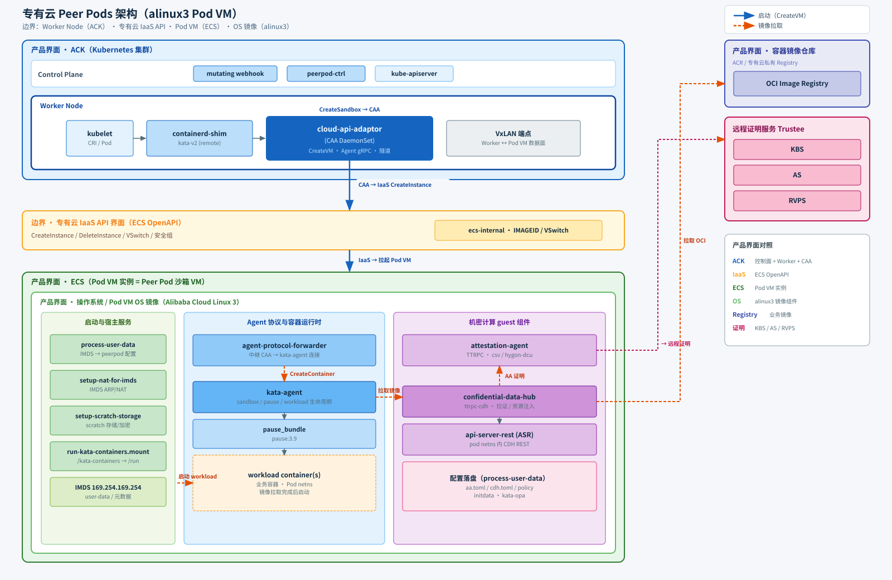

# 专有云 Peer Pods 架构

本文描述本仓库在 **专有云** 上的 Peer Pods / Pod VM 架构与组件。通用 Peer Pods 背景见 [architecture-upstream.md](./architecture-upstream.md)。

## 架构图



## alinux3 Pod VM 组件清单

下列组件放入 alinux3 专有云 base 镜像（目录树见仓库 `work/podvm-alinux3-tree/`）。

| 组件 | 作用 | 源码链接 + tag | 构建方式 |
|---|---|---|---|
| `process-user-data` | 从 IMDS/user-data 解析并落盘 peerpod 配置（`aa.toml` / `cdh.toml` / policy / initdata 等） | [cloud-api-adaptor](https://code.alibaba-inc.com/mading.ma/cloud-api-adaptor) `cmd/process-user-data`（本仓库分支） | `cd src/cloud-api-adaptor && CGO_ENABLED=0 make process-user-data`（Go 静态） |
| `agent-protocol-forwarder` | 将 CAA 的 agent 协议（TCP/mTLS）转发到本机 `kata-agent` Unix socket | [cloud-api-adaptor](https://code.alibaba-inc.com/mading.ma/cloud-api-adaptor) `cmd/agent-protocol-forwarder`（本仓库分支） | `cd src/cloud-api-adaptor && CGO_ENABLED=0 make agent-protocol-forwarder`（Go 静态） |
| `kata-agent` | Pod VM 内容器生命周期管理（sandbox / pause / workload） | [kata-containers](https://code.alibaba-inc.com/mading.ma/kata-containers) tag **`v4.0.0`**（`cf82bb35`） | `podvm/hack/build-kata-agent-musl.sh <kata-src> <install-path>`（musl 静态） |
| `attestation-agent` | guest 内 TTRPC 证明服务（CSV / Hygon DCU） | [inclavare-containers/guest-components](https://github.com/inclavare-containers/guest-components) @ **`b4986c1`** → `attestation-agent` | musl 静态：`make build LIBC=musl ATTESTER=csv-attester,hygon-dcu-attester`（产物改名为 `attestation-agent`；推荐 Ubuntu + musl-tools） |
| `confidential-data-hub` | 密文资源注入、镜像拉证、KMS（含阿里云）等；ttrpc 常驻 daemon（非 oneshot） | 同上 @ **`b4986c1`** → `confidential-data-hub`（`ttrpc-cdh`） | musl 静态：`cargo build -p confidential-data-hub --release --bin ttrpc-cdh --features "bin,ttrpc,kbs,aliyun,resource_injection" --target x86_64-unknown-linux-musl` |
| `api-server-rest` | 在 pod netns 内提供 CDH REST API（ASR） | 同上 @ **`b4986c1`** → `api-server-rest` | musl 静态：`cd api-server-rest && make build LIBC=musl` |
| `pause_bundle` | Kubernetes pause 容器 rootfs，供 kata-agent 创建 sandbox | OCI：[`registry.k8s.io/pause:3.9`](https://registry.k8s.io/pause:3.9)（见 `versions.yaml` `oci.pause`） | skopeo 拉镜像 + umoci unpack 到 `pause_bundle/` |
| `setup-nat-for-imds` | IMDS（`169.254.169.254`）代理 ARP/NAT，供 guest 访问元数据 | 本仓库 `podvm/files/usr/local/bin/setup-nat-for-imds.sh` | 脚本，无需编译 |
| `setup-scratch-storage` | 按 marker 配置 kata scratch 存储（加密/挂载等） | 同上 `setup-scratch-storage` | 脚本，无需编译 |
| `run-kata-containers` mount | 将 `/kata-containers` 挂到 `/run/kata-containers` | 同上 `run-kata\x2dcontainers.mount` | systemd mount 单元，无需编译 |

对应 systemd 单元：`process-user-data.service`、`agent-protocol-forwarder.service`、`setup-nat-for-imds.service`、`scratch-storage.service`、`run-kata\x2dcontainers.mount`，以及 `attestation-agent` / `confidential-data-hub` / `kata-agent` / `api-server-rest` 的 `.path`+`.service`；另含 `netns@.service`。

Guest 收尾脚本：`src/cloud-api-adaptor/podvm/hack/guest-setup.sh`（`customize-alinux3-image.sh` 也会调用）。

## 目录树要点（`work/podvm-alinux3-tree/`）

```text
work/podvm-alinux3-tree/
├── etc/systemd/system/          # *.service / *.path / *.mount + multi-user.target.wants
├── etc/agent-config.toml        # kata-agent 配置
├── etc/kata-opa/                # agent policy
├── usr/local/bin/               # 全部组件二进制与辅助脚本
├── pause_bundle/                # pause 容器 rootfs
├── guest-setup.sh               # 从 hack/guest-setup.sh 拷贝（work/ 不入库）
└── MANIFEST.txt
```

## 专有云 适配要点

| 模块 | 上游行为 | 专有云 适配 |
|------|----------|-----------|
| Pod VM 基础 OS | Ubuntu + mkosi | alinux3 Koji base qcow2 + virt-customize |
| kata-agent | oras 拉 OCI 预编译包 | 从 [kata-containers](https://code.alibaba-inc.com/mading.ma/kata-containers) 源码 **musl 静态**编译 |
| guest-components | oras 拉 OCI 预编译包 | 从 [inclavare-containers/guest-components](https://github.com/inclavare-containers/guest-components) **musl 静态**编译（AA 仅 `csv-attester,hygon-dcu-attester`） |
| user-data | `#cloud-config` write_files | bash 脚本（`USER_DATA_FORMAT=script`） |
| initdata 解压 | process-user-data | 不变，脚本写入 `/run/peerpod/initdata` 后照常解压 |

构建见 [development.md](./development.md)；集群部署见 [deployment.md](./deployment.md)。
